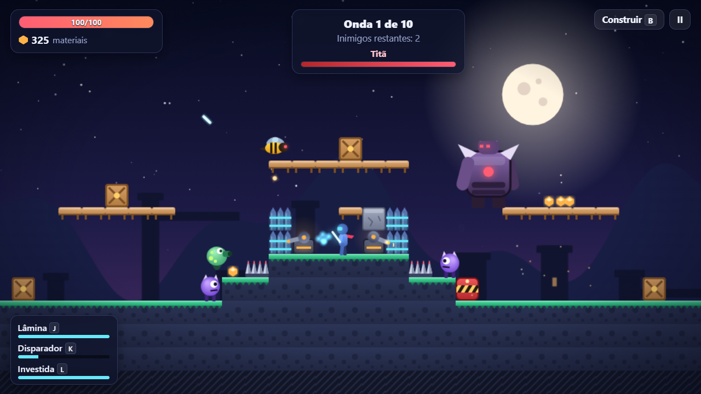
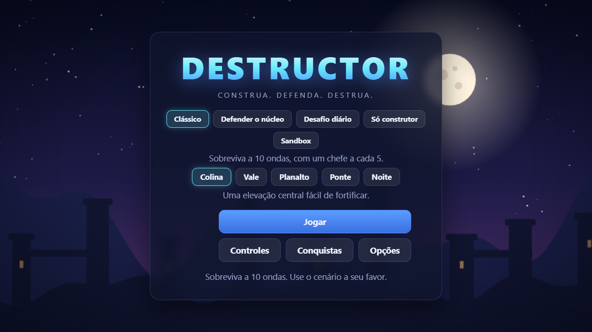
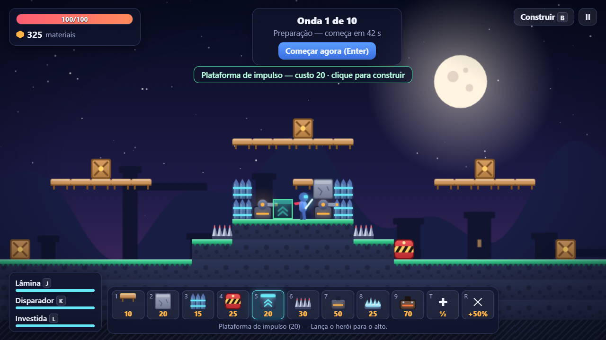
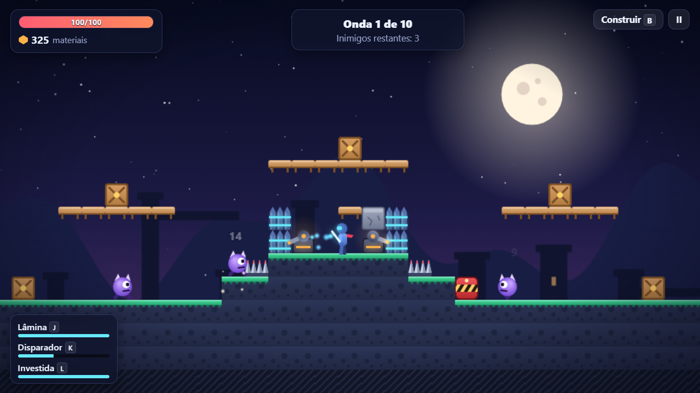
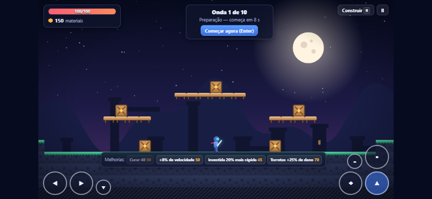
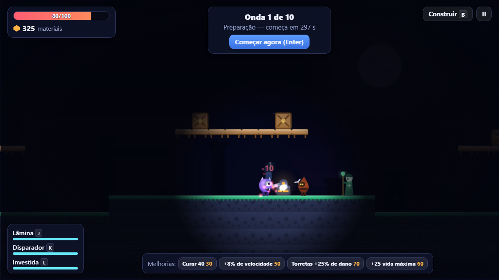
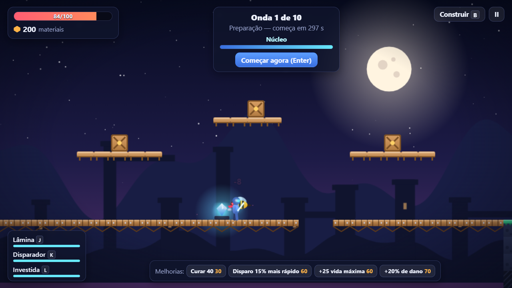

# DESTRUCTOR

Um jogo de ação e plataforma 2D em que você constrói o cenário enquanto luta. Levante paredes, espalhe armadilhas, instale torretas e segure as ondas de inimigos do jeito que der.

Roda direto no navegador, para um jogador. Feito com Phaser 3, TypeScript e Vite.

**▶ [Jogar agora](https://game-destructor.vercel.app)**

[](https://github.com/KawanVictor/GAME-DESTRUCTOR/actions/workflows/ci.yml)



| Escolha a arena | Monte suas defesas |
|---|---|
|  |  |

| Segure a onda | Jogue no celular |
|---|---|
|  |  |

| Enxergue no escuro | Derrube no abismo |
|---|---|
|  |  |

## Bora jogar

O jeito mais rápido é abrir **[game-destructor.vercel.app](https://game-destructor.vercel.app)**.

Para rodar na sua máquina, você só precisa do [Node.js](https://nodejs.org) (versão 20.19 ou mais nova).

```bash
npm install
npm run dev
```

Abra http://localhost:5173, escolha o modo e a arena e clique em **Jogar**.

## Como funciona

São 10 ondas de inimigos. Entre uma e outra você ganha um tempinho para construir, consertar o que quebrou e comprar melhorias. A cada 5 ondas aparece um chefe. Passou da décima? Dá para continuar no modo infinito e ver até onde aguenta.

Na primeira partida, umas dicas rápidas aparecem na tela mostrando o básico. Dá para pular se você já sabe jogar.

### Modos

| Modo | Como é |
|---|---|
| Clássico | As 10 ondas, do jeito de sempre |
| Defender o núcleo | Tem um cristal do seu lado e os inimigos vão direto nele. Se ele cair, acabou |
| Desafio diário | A arena, as regras das ondas e as melhorias à venda são sorteadas pela data, iguais para todo mundo no mesmo dia. Toda onda (menos as primeiras e as de chefe) vem com uma regra especial |
| Só construtor | Você não ataca. Só as suas defesas lutam, mas você começa com mais materiais |
| Sandbox | Materiais infinitos e nenhuma onda. Você chama os inimigos que quiser num painel, para testar defesas à vontade |

### Controles

| Para | Aperte |
|---|---|
| Andar | A / D ou as setas |
| Pular (segure para ir mais alto) | Espaço |
| Descer de uma plataforma de madeira | S + Espaço |
| Golpear | J |
| Atirar | K |
| Investida | L ou Shift |
| Abrir o menu de construção | B |
| Escolher a peça | 1 a 9, ou clique nela |
| Construir, consertar ou demolir | Clique esquerdo no cenário |
| Cancelar | Clique direito |
| Ferramenta de conserto | T |
| Ferramenta de demolição | R |
| Começar a onda logo | Enter |
| Pausar | Esc |

Não curtiu alguma tecla? Troque em **Opções**, no menu ou na pausa.

No celular ou tablet aparecem botões na tela para andar, pular e atacar, e é só tocar no cenário para construir.

Também dá para jogar com controle (Xbox, PlayStation e parecidos): analógico ou direcional para andar, **A** pula, **X** golpeia, **B** ou **RT** atira, **RB** faz a investida, **Y** abre a construção, **LB** começa a onda e **Start** pausa. Para posicionar as peças ainda é preciso o mouse ou o toque.

### Dicas de combate

- **O tiro mira sozinho** no inimigo mais próximo à sua frente, mesmo que ele esteja acima ou abaixo de você.
- **A investida deixa você invulnerável** por um instante. Ótima para atravessar um grupo ou fugir do golpe do chefe.
- **O golpe bate mais forte** que o tiro, quebra caixotes e detona seus explosivos.

### Peças

| Peça | Custo | Para que serve |
|---|---|---|
| Plataforma de madeira | 10 | Dá para subir por baixo dela |
| Bloco de pedra | 20 | Aguenta muito e bloqueia todo mundo |
| Parede defensiva | 15 | Barra os inimigos, mas você e seus tiros passam |
| Bloco explosivo | 25 | Explode quando é destruído; um golpe ou tiro seu detona na hora |
| Plataforma de impulso | 20 | Joga você lá no alto, até as plataformas elevadas |
| Armadilha de espinhos | 30 | Machuca quem pisa; vai gastando com o uso |
| Torreta | 50 | Atira sozinha em quem chega perto |
| Armadilha de gelo | 25 | Deixa lento quem pisa; vai gastando com o uso |
| Canhão | 70 | Atira devagar, mas cada tiro explode e acerta um grupo |

Você começa com 150 materiais e ganha mais derrotando inimigos, quebrando os caixotes da arena e vencendo ondas.

Algumas regrinhas na hora de construir:

- A peça precisa estar perto de você e encostada em algo que já existe.
- Armadilhas e torretas precisam de chão firme embaixo.
- Não dá para construir em cima de alguém, nem colado nos portais dos inimigos.
- O jogo não deixa você se emparedar sem saída.

A prévia fica verde quando pode e vermelha quando não pode, e já diz o motivo.

Consertar uma peça sai mais barato do que refazer. Demolir devolve metade do que ela custou. Se um inimigo destruir, aí não volta nada.

### Inimigos

| Inimigo | Aparece na | O que ele faz | Como lidar |
|---|---|---|---|
| Rastejador | Onda 1 | Vem andando e ataca suas paredes | Qualquer defesa segura |
| Corredor | Onda 2 | Rápido, frágil e pula paredes | Golpe e espinhos |
| Vespa | Onda 3 | Voa por cima de tudo e mergulha em você | Torretas ou tiro |
| Colosso | Onda 4 | Lento, resistente e derruba estruturas | Explosivos, e conserte depois |
| Sabotador | Onda 4 | Ignora você e corre para quebrar torretas, armadilhas e paredes | Pegue ele no caminho, antes que chegue |
| Cuspidor | Onda 5 | Fica de longe atirando | Esconda-se atrás de paredes e blocos |
| Curandeiro | Onda 6 | Fica lá atrás curando os outros (menos o chefe) | Derrube ele primeiro |
| Titã (chefe) | Ondas 5, 10, 15… | Arrebenta tudo e pula em você com um golpe de área | Pule ou use a investida na hora do golpe |

### Melhorias

A cada intervalo ficam à venda a **cura** (sempre) e **três melhorias sorteadas**: mais vida, mais dano, tiro mais rápido, mais velocidade, torretas mais fortes ou investida que recarrega mais depressa. Vencer uma onda também devolve um pouco de vida.

### Regras especiais das ondas

A partir da terceira onda, às vezes uma onda chega com uma regra diferente (no desafio diário, sempre):

| Regra | O que muda |
|---|---|
| Pressa | Inimigos 30% mais rápidos |
| Blindados | Inimigos com 35% mais vida |
| Chuva de meteoros | Pedras caem do céu perto de você, e acertam todo mundo (inclusive você e suas peças) |
| Neblina | Só dá para ver perto de você e das suas defesas |
| Recompensa | Vêm mais inimigos, mas vencer a onda paga o dobro |

### Arenas

| Arena | Como é |
|---|---|
| Colina | Um morro no meio, fácil de fortificar. Boa para começar |
| Vale | Você fica embaixo e os inimigos descem dos dois lados |
| Planalto | Bem aberta e larga, com um platô comprido |
| Ponte | Uma ponte de tábuas sobre um abismo. Quebre as tábuas e os inimigos caem (mas cuidado: você também cai) |
| Noite | Escuridão total. Só se enxerga perto de você, das torretas e dos portais |

### Conquistas

São 12, como vencer o Titã, derrotar 4 inimigos com uma explosão só ou vencer sem nenhuma torreta. Elas ficam salvas no navegador e aparecem no botão **Conquistas** do menu.

## Quer colocar no ar?

```bash
npm run build
```

Isso cria a pasta `dist/` com o jogo pronto. É só subir essa pasta em qualquer hospedagem de site estático, como Netlify, Vercel, Cloudflare Pages ou GitHub Pages. Para conferir antes, rode `npm run preview`.

## Para desenvolvedores

### Comandos

| Comando | O que faz |
|---|---|
| `npm run dev` | Servidor de desenvolvimento |
| `npm run build` | Checagem de tipos e build de produção em `dist/` |
| `npm run typecheck` | Só a checagem de tipos |
| `npm test` | 95 testes unitários (Vitest) |
| `npm run test:e2e` | 28 testes de navegador (Playwright, no Chrome) |
| `BROWSERS=all npm run test:e2e` | Os mesmos testes em Chrome, Firefox e WebKit |
| `npm run playthrough` | Um robô joga a partida inteira e relata cada onda |
| `npm run screenshots` | Regenera as imagens deste README |

A cada push, o GitHub Actions roda a checagem de tipos, os testes unitários, o build e os testes de navegador.

### Como o código está organizado

```
src/game/
  systems/    regras do jogo, sem Phaser: construção, recursos, ondas,
              combate, salvamento, desafio diário, conquistas
              (é o que os testes unitários cobrem)
  data/       balanceamento em tabelas: peças, inimigos, ondas, armas,
              modos, regras especiais e conquistas
  entities/   herói, inimigos e projéteis
  world/      arenas, tilemap e torretas
  scenes/     cenas do Phaser, que ligam as regras ao motor
    game/     controladores da partida: entrada (teclado, toque e controle),
              combate, construção, inimigos, coletáveis, escuridão,
              meteoros e progresso (conquistas e tutorial)
  ui/         HUD, menus, opções e controles de toque (HTML sobre o canvas)
  art/        arte desenhada por código
tests/        testes unitários
e2e/          testes de navegador
scripts/      robô de balanceamento e gerador de capturas
```

Algumas escolhas que valem contar:

- **As regras não conhecem o motor.** Construção, ondas, dano e salvamento são TypeScript puro; as cenas só os conectam ao Phaser. Por isso dá para testá-los sem abrir um navegador.
- **Balanceamento é dado, não código.** Um inimigo novo é uma linha em uma tabela; um modo novo também.
- **O desafio diário não precisa de servidor.** A data vira a semente de um gerador pseudoaleatório, então todo mundo recebe a mesma arena e os mesmos sorteios.
- **Reiniciar é criar uma partida nova.** Todo o estado nasce do zero, então nada vaza de uma partida para a outra.
- **Os testes de navegador rodam sob a mesma política de segurança da produção** (Content-Security-Policy, definida em `vercel.json`), e falham se ela bloquear qualquer coisa.
- **A API usada pelos testes não vai para produção.** Ela só existe em um build separado, e o CI confere que o pacote publicado não a contém.

### Balanceamento com um robô

As ondas foram ajustadas com `npm run playthrough`: um robô joga a partida inteira pelo teclado e mouse, em tempo real. Ele monta um forte simples, luta parado, coleta materiais, conserta e compra melhorias. Não desvia de nada, então funciona como piso: quem joga com atenção se sai melhor. Depois dos ajustes, o jogo também foi conferido à mão: partidas completas nas três arenas, o golpe de área do chefe, todos os controles e todas as peças.

Última partida dele na Colina, já com Sabotadores, Curandeiros e as regras especiais, vencendo as 10 ondas:

| Onda | Regra | Duração | Abates | Vida antes → depois |
|---|---|---|---|---|
| 1 | — | 34 s | 3 | 100 → 100 |
| 2 | — | 36 s | 6 | 100 → 100 |
| 3 | Chuva de meteoros | 41 s | 9 | 100 → 100 |
| 4 | Recompensa | 56 s | 17 | 100 → 100 |
| 5 (chefe) | — | 54 s | 10 | 100 → 63 |
| 6 | Blindados | 68 s | 22 | 63 → 36 |
| 7 | — | 69 s | 27 | 76 → 65 |
| 8 | — | 67 s | 30 | 65 → 45 |
| 9 | Neblina | 69 s | 35 | 110 → 99 |
| 10 (chefe) | — | 61 s | 19 | 99 → 64 |

O que essas partidas mudaram no jogo:

- **O bug da Vespa.** Na primeira partida, o robô travou na onda 3: a Vespa ficava parada no portal e a onda nunca acabava. O arrasto da física, pensado para inimigos que andam, anulava a aceleração do voo. Nenhum teste tinha pegado isso.
- **Cura sempre à venda.** Ela dependia de sorteio, e o robô chegou a entrar em uma onda com 6 de vida sem ter como se curar.
- **Começo mais exigente.** As quatro primeiras ondas não causavam dano nenhum.
- **Menos materiais por onda.** Sobrava tanto que o robô acumulou 655 sem ter onde gastar.
- **Chefe menos punitivo.** Em uma versão intermediária, ele derrubava o robô com a vida cheia.
- **Sabotador mais fraco e Curandeiro longe do chefe.** Com o conteúdo novo, o robô passou a perder na onda 9 ou 10: o Sabotador desmontava as torretas em dois segundos e os Curandeiros mantinham o Titã de pé. O Sabotador agora vem em menor número e bate menos nas peças, o Curandeiro não cura o Titã e nenhum dos dois escolta o chefe.

### O que ainda falta

- A dificuldade foi calibrada pelo robô e conferida em partidas manuais do autor; falta o retorno de outras pessoas jogando.
- Partidas completas nas três arenas originais e o golpe de área do chefe foram conferidos à mão; ainda não há teste automatizado para eles.
- Os modos novos, a Ponte, a Noite, as peças e os inimigos novos foram testados no navegador (automático) e pelo robô no Clássico, mas ainda não em partidas manuais completas.
- Os controles de toque e o controle foram testados com eventos simulados, não em aparelhos de verdade. Com controle, as peças ainda são posicionadas com mouse ou toque.
- No WebKit, 8 dos 28 testes ficam de fora: a versão que o Playwright oferece no Windows roda o jogo devagar demais para testes que dependem de tempo de resposta.
- Ideias que ficaram para depois: cooperativo local, campanha com fases, editor de arenas, ranking online e desbloqueios entre partidas.

## Licença

[MIT](LICENSE) © 2026 Kawan Victor Cavalcante
